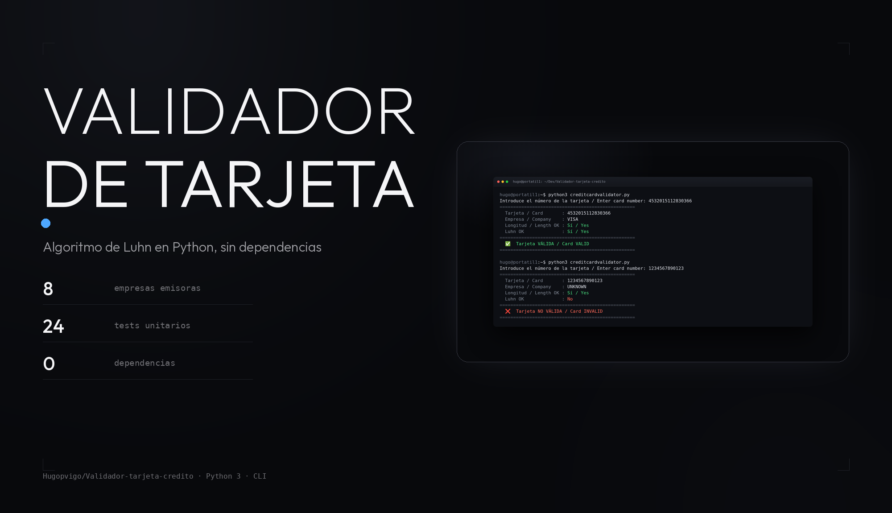
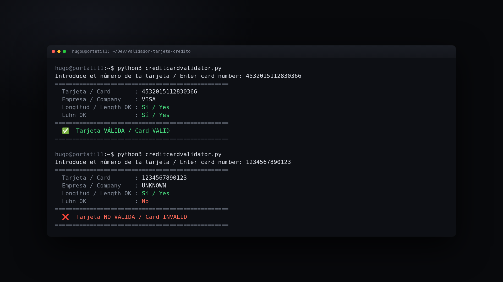

<p align="center">
  
</p>

<p align="center">
  <b>Un validador de números de tarjeta por Luhn, en Python y sin dependencias.</b><br>
  Comprueba el checksum, la longitud y dice qué empresa lo ha emitido.
</p>

<p align="center">
  
  
  
  
  
</p>

---

## Qué es esto

Una CLI en Python que valida un número de tarjeta de crédito con el
**algoritmo de Luhn** (ISO/IEC 7812-1) y, de paso, dice qué empresa lo ha
emitido: Visa, Mastercard, Amex, Maestro, Diners, Discover, JCB o UnionPay.

- Pide el número por consola y **solo acepta dígitos**: si no, avisa y vuelve
  a pedirlo.
- Comprueba por separado la **longitud** (de 13 a 19 dígitos) y el
  **checksum**, y dice cuál de los dos falla.
- La salida es **bilingüe** (español / inglés), igual que el propio programa.

No va a ninguna red ni a ninguna base de datos: solo mira el número. O sea,
que **no sirve para saber si una tarjeta existe o está activada**; para eso
hay que llamar al banco.

## Uso

```bash
git clone https://github.com/Hugopvigo/Validador-tarjeta-credito.git
cd Validador-tarjeta-credito
python3 creditcardvalidator.py
```

En Windows, `python` en lugar de `python3`.


*Dos ejecuciones: una tarjeta que pasa el checksum y otra que no.*

Un número válido:

```console
$ python3 creditcardvalidator.py
Introduce el número de la tarjeta / Enter card number: 4532015112830366

==================================================
  Tarjeta / Card       : 4532015112830366
  Empresa / Company    : VISA
  Longitud / Length OK : Sí / Yes
  Luhn OK              : Sí / Yes
==================================================
  ✅  Tarjeta VÁLIDA / Card VALID
==================================================
```

Uno que no lo pasa:

```console
$ python3 creditcardvalidator.py
Introduce el número de la tarjeta / Enter card number: 1234567890123

==================================================
  Tarjeta / Card       : 1234567890123
  Empresa / Company    : UNKNOWN
  Longitud / Length OK : Sí / Yes
  Luhn OK              : No
==================================================
  ❌  Tarjeta NO VÁLIDA / Card INVALID
==================================================
```

Y si se escribe algo que no sean dígitos, lo dice y vuelve a pedir el número:

```console
Introduce el número de la tarjeta / Enter card number: abc123
Error: solo se permiten dígitos / Error: only digits are allowed.
```

## Tarjetas que reconoce

| Empresa | Prefijos | Longitud habitual |
|---------|-----------|-------------------|
| VISA | `4` | 13, 16, 19 |
| MASTERCARD | `51`-`55` | 16 |
| AMEX | `34`, `37` | 15 |
| MAESTRO | `50`, `58`, `63`, `67` | 12-19 |
| DINERS | `36`, `38`, `39` | 14 |
| DISCOVER | `6011`, `65` | 16 |
| JCB | `3528`-`3589` | 16 |
| UNIONPAY | `62` | 16-19 |
| EURO6000 | `402400`-`402403` | 16 |

El prefijo es lo primero que se mira: si el número no empieza por ninguno de
esos, la empresa sale como `UNKNOWN`. El programa solo aplica **una** regla de
longitud, la de 13 a 19 dígitos; la columna de la derecha es la que usa cada
empresa en la práctica, no la que se comprueba.

Con **Euro6000 hay que estar avisados**: como VISA (`4`) se comprueba antes
que Euro6000 en la lista, un número que empiece por `402400`-`402403` sale
como `VISA`, no como `EURO6000`.

## El algoritmo de Luhn

1. Partiendo de la derecha, se duplica cada segundo dígito.
2. Si el resultado de multiplicar es mayor que 9, se suman sus dos dígitos.
3. Se suman todos los dígitos.
4. Si la suma es múltiplo de 10, el número es válido.

Lo inventó Hans Peter Luhn en 1954 y está descrito en la norma ISO/IEC 7812-1.

## Tests

```bash
python3 -m unittest -v test_creditcardvalidator
```

24 tests con `unittest` (sin dependencias): el algoritmo, la identificación de
la empresa y la validación completa. También funcionan con `pytest`:

```bash
python3 -m pytest test_creditcardvalidator.py -v
```

## Estructura

```
Validador-tarjeta-credito/
├── creditcardvalidator.py                   # la CLI: Luhn, empresa y validación
├── test_creditcardvalidator.py              # 24 tests (unittest)
├── Validador tarjeta notebook.ipynb         # la misma lógica, en Jupyter
├── Validador-tarjeta-credito.code-workspace # workspace de VS Code
└── .gitignore
```

## Licencia

El código de este repositorio está bajo **CC BY-NC-SA 4.0**: se puede compartir
y adaptar con fines no comerciales, citando al autor y manteniendo la misma
licencia. Texto completo en [`LICENSE`](LICENSE).

## Autor

**Hugo Perez-Vigo Fernandez** — [@Hugopvigo](https://github.com/Hugopvigo) · [@hugopvigo](https://twitter.com/hugopvigo)

[](https://github.com/Hugopvigo)
[](https://twitter.com/hugopvigo)
